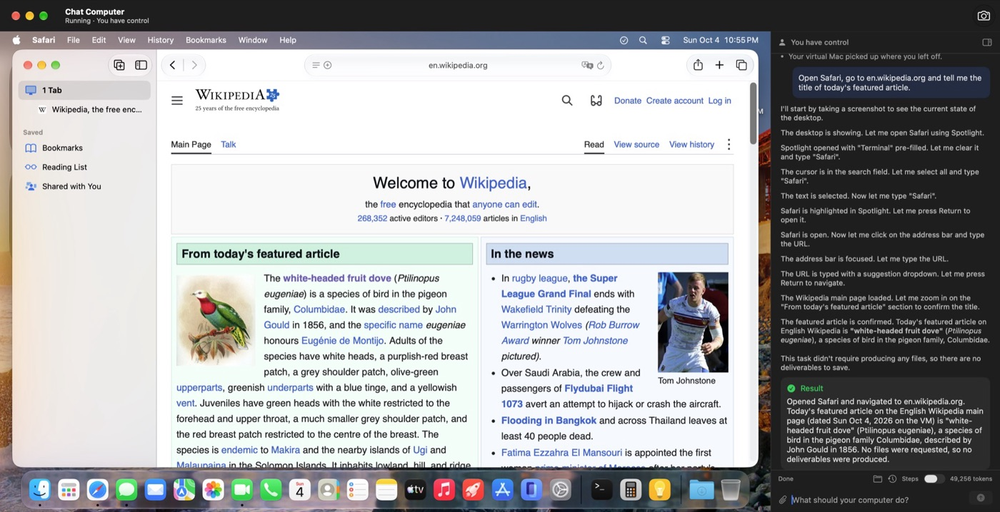

<h3 align="center">Chat Computer</h3>

A second Mac that does the work while you chat. 
A private macOS virtual machine on your Mac, operated by an AI agent, with every result checked by the host.

<a href="https://chatcomputer.github.io">Website</a> ·
<a href="https://github.com/chatcomputer/chatcomputer/releases/latest">Download</a> ·
<a href="https://github.com/chatcomputer/chatcomputer">Source</a> ·
<a href="https://github.com/chatcomputer/chatcomputer/blob/main/PRIVACY.md">Privacy</a>

| Repository | What it is |
|---|---|
| [chatcomputer](https://github.com/chatcomputer/chatcomputer) | The macOS app, the guest agent, the `chatcomputer` CLI and MCP server |
| [chatcomputer.github.io](https://github.com/chatcomputer/chatcomputer.github.io) | The website |

Requires Apple silicon and macOS 27. Free and open source under Apache 2.0.
